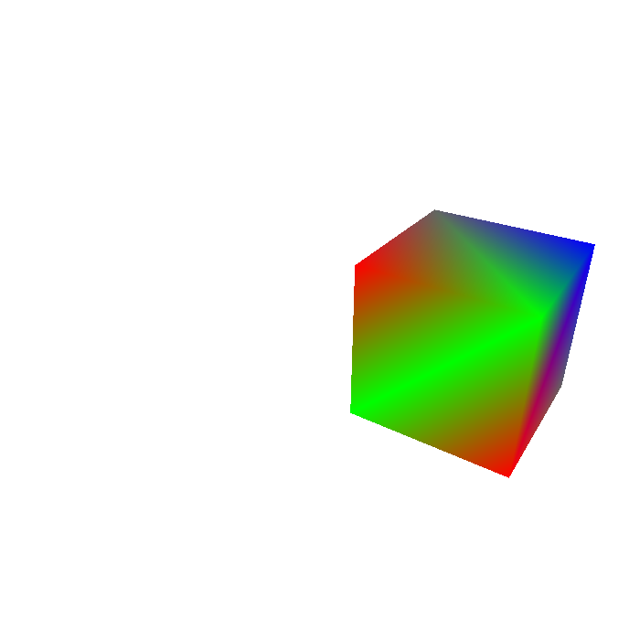
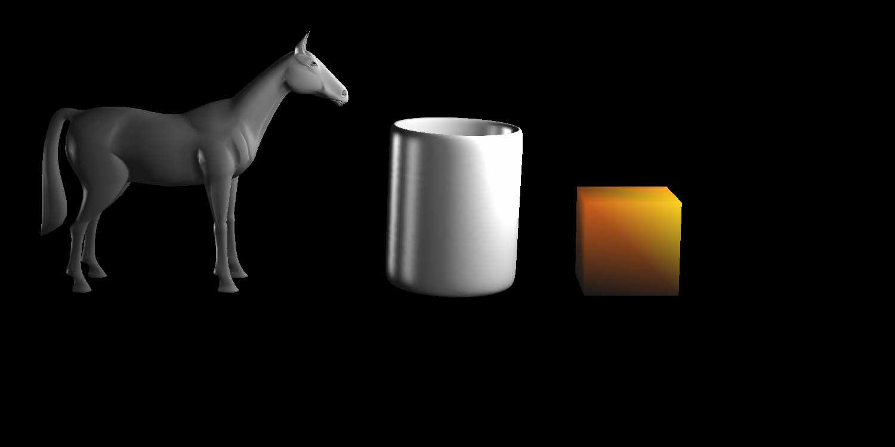

# Forward Rendering Pipeline

A software rasterizer implementing core stages of the forward rendering pipeline in C++. Built as part of CENG 477 - Introduction to Computer Graphics at METU.

## Overview

Given a 3D scene described in XML (meshes, instances, cameras, and transformations), the program produces raster images in PPM format without a GPU or graphics API.

The project was built on a course-provided scaffold for data structures, XML parsing, and math utilities. The rendering pipeline is implemented in `Scene.cpp`, with transformation and clipping helpers in `Helpers.cpp`. The original assignment implementation is preserved.

## Pipeline Stages

- **Modeling transformations** - Translation, rotation, and scaling applied to mesh instances in the order listed in the XML
- **Viewing transformation** - Camera space transformation using gaze, up, and position vectors
- **Projection** - Perspective and orthographic projection
- **Backface culling** - Normal-based culling in world space, enabled or disabled per scene
- **Clipping** - Outcode-based, Cohen-Sutherland-style line clipping in homogeneous coordinates for wireframe mode
- **Rasterization** - Bresenham-style incremental line drawing for wireframe edges and barycentric interpolation for filled triangles
- **Depth buffering** - Per-pixel depth testing for solid triangles

## Rendering Modes

- **Wireframe** - Draws triangle edges with clipping and interpolated vertex colors
- **Solid** - Fills triangles with interpolated vertex colors and depth testing

## Build & Run

Requires a C++ compiler (`g++`) and GNU Make. The commands below assume a Unix-like shell, such as Linux or an MSYS2 terminal on Windows. tinyxml2 is included in the repository; it does not require a separate installation.

Run these commands from the repository root:

```bash
git clone https://github.com/dou186f/forward-rendering-pipeline.git
cd forward-rendering-pipeline
make rasterizer
./rasterizer inputs_outputs/inputs_outputs/culling_disabled_inputs/sample.xml
```

This example writes `sample.ppm` to the current working directory. Each camera's `<OutputName>` specifies its output filename; a scene with multiple cameras can produce multiple images. Relative output paths are resolved from the directory where the program is run, rather than the XML file's directory. Any parent output directory must already exist.

On toolchains that do not expose `strdup` in strict C++11 mode, such as the MSYS compiler used during verification, build with GNU C++11 extensions:

```bash
make rasterizer CXXFLAGS="-g -std=gnu++11 -Wall"
```

The input filename is a command argument: do not surround it with literal `<` and `>` characters. On Windows, the built executable may be named `rasterizer.exe`.

To convert the sample output to PNG with [ImageMagick 7](https://imagemagick.org/script/magick.php):

```bash
magick sample.ppm sample.png
```

ImageMagick is optional and is only needed for conversion. On Windows, the system command named `convert` is unrelated to ImageMagick.

## Example Scenes and Outputs

The supplied examples are currently nested under `inputs_outputs/inputs_outputs/`:

| Folder | Contents |
|---|---|
| `culling_disabled_inputs/` | XML scenes with backface culling disabled |
| `culling_enabled_inputs/` | XML scenes with backface culling enabled |
| `culling_disabled_outputs/` | Supplied PNG outputs for the culling-disabled examples |
| `culling_enabled_outputs/` | Supplied PNG outputs for the culling-enabled examples |
| `different_projection_type/` | Perspective and orthographic variants of the flag and horse-and-mug scenes |
| `clipping_example/` | A wireframe clipping scene with two camera outputs |

For example:

```bash
./rasterizer inputs_outputs/inputs_outputs/clipping_example/empty_box_clipped.xml
```

This writes `empty_box_clipped_1.ppm` and `empty_box_clipped_2.ppm` to the current working directory. Different scenes can reuse output filenames, so use separate working directories if you want to preserve every render.

Supplied PNG examples:

| Sample scene | Horse and mug |
|---|---|
|  |  |

Generated `.ppm` files and executables are ignored by `.gitignore`; the supplied XML and PNG files can be tracked normally. Use a fresh build of the repository source rather than executables included in the example folders.

## Input Format

See [sample.xml](inputs_outputs/inputs_outputs/culling_disabled_inputs/sample.xml) for a complete input.

- `<BackgroundColor>` contains the red, green, and blue background values.
- `<Culling>` is `enabled` or `disabled`.
- `<Cameras>` contains cameras with a `perspective` or `orthographic` type, plus `Position`, `Gaze`, `Up`, `ImagePlane`, and `OutputName` fields.
- `<ImagePlane>` values are ordered as `left right bottom top near far horizontalResolution verticalResolution`.
- `<Vertices>` lists positions and RGB colors. Mesh faces reference vertices with one-based indices in file order.
- `<Translations>`, `<Scalings>`, and `<Rotations>` define transformations. Rotation values are `angleInDegrees axisX axisY axisZ`.
- `<Meshes>` contains triangle faces, each written as three vertex indices.
- `<Instances>` references meshes and selects `wireframe` or `solid` rendering. Its `<Transformations>` entries use lowercase `t`, `s`, or `r`, followed by the transformation reference, such as `r 1`.

The parser expects the supplied assignment format. Keep mesh and transformation definitions in one-based reference order and retain the container elements even when they are empty. Start the XML directly with `<Scene>`, as in the examples, without an XML declaration or leading comment. Cameras in the same scene should use the same image resolution.

## Limitations

This repository preserves the assignment implementation. Clipping is implemented for wireframe edges; solid triangles do not have full frustum clipping. Wireframe rendering does not use the depth buffer, and orthographic backface culling has known limitations. The supplied output images illustrate the scenes and are not a claim that every rendering case passes an automated comparison.

## Tech Stack

- **Language:** C++11
- **Build:** GNU Make and g++
- **XML Parsing:** tinyxml2, included in the repository
- **Output Format:** PPM (ASCII P3)

## Author

**Doğu Erbaş**  
doguerbass@gmail.com  
METU Computer Engineering - CENG 477
